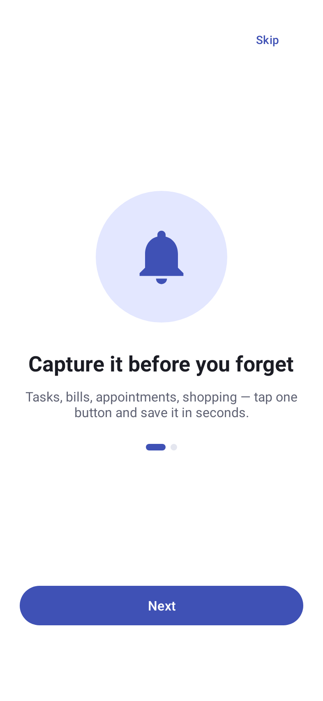
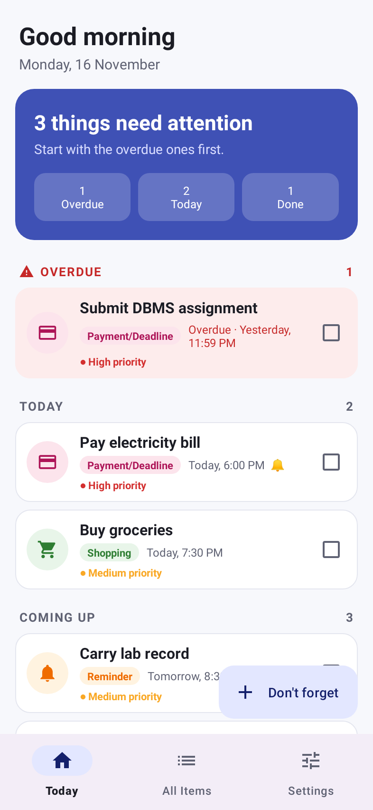
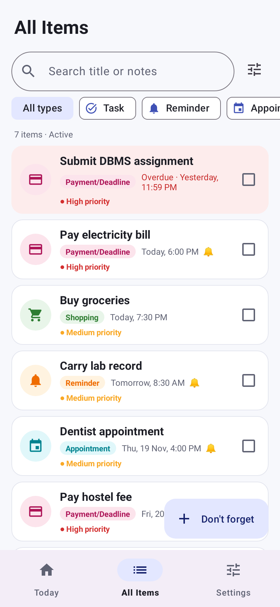
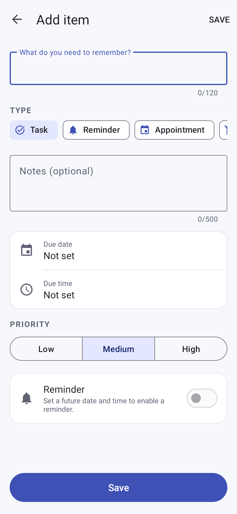
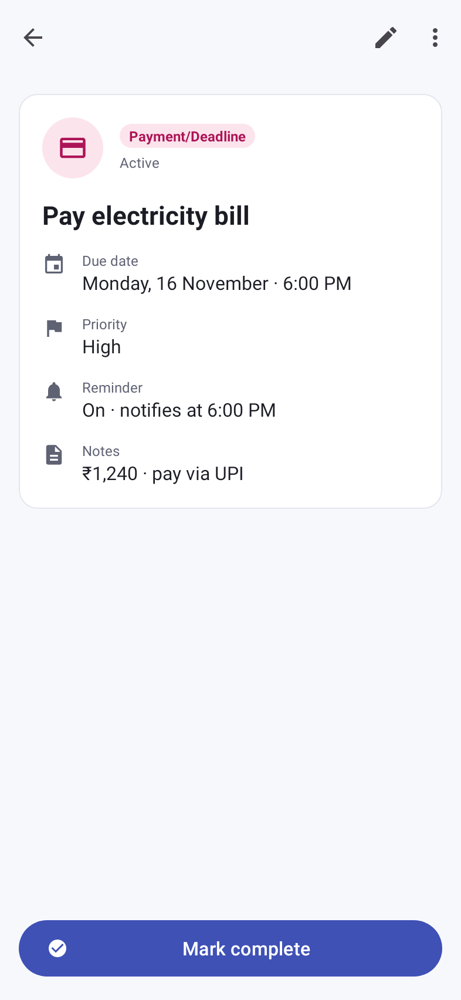
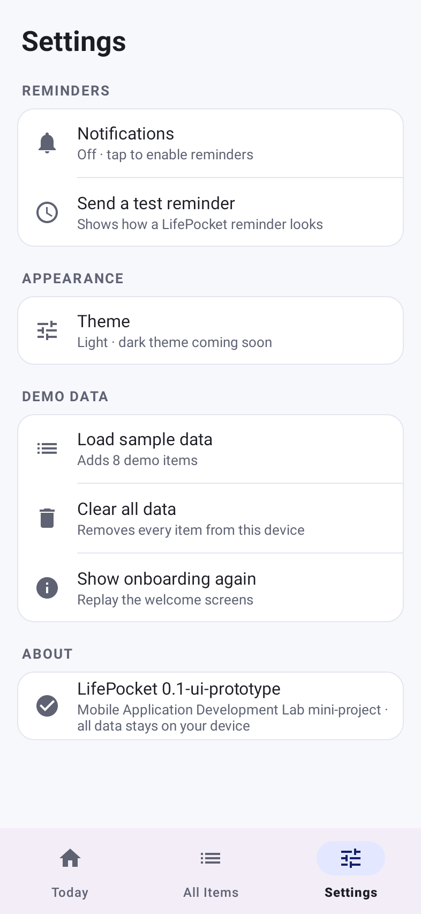
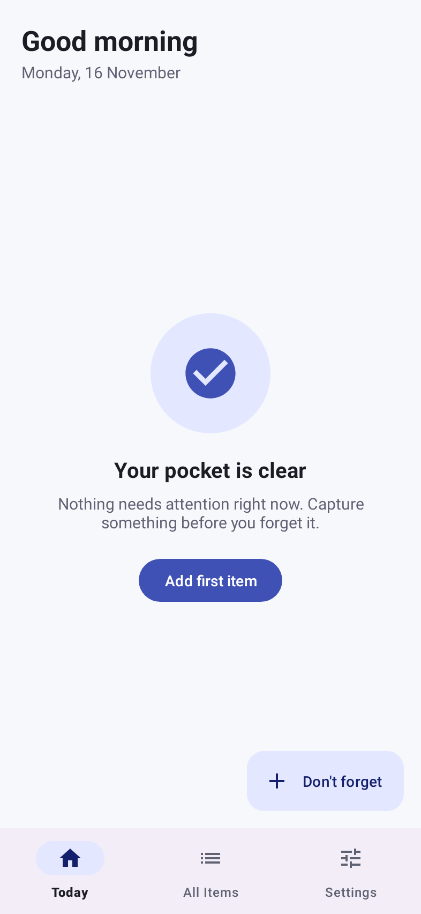

# LifePocket

A personal life assistant for remembering everyday commitments: tasks, reminders, appointments, shopping, and payments/deadlines.
This is an Android mini-project for the Mobile Application Development Lab, built with **Java + XML** in a standard Android Studio (Gradle) layout.

> **Status: UI prototype (First Review).** Every screen from the PRD is built and navigable, using sample data.
> Data is saved on the device with a simple local store. Room, WorkManager-scheduled reminders, and MVVM come in the next phases (see the PRD).

## Screens

| Onboarding | Today | All Items | Add item |
|---|---|---|---|
|  |  |  |  |

| Item detail | Settings | Empty state |
|---|---|---|
|  |  |  |

## What works in the prototype

- First-run onboarding (2 pages) with **Load sample items**
- **Today** dashboard: summary card, then Overdue (red), Today, and Coming up sections
- **Don't forget** button opens the quick-add form: title validation, 5 type chips, notes, Material date/time pickers, priority, and a reminder switch that only turns on for a future date and time
- **All Items**: live search (title and notes), type chips, a filter bottom sheet (status and date group), swipe left to delete (with confirmation), and an empty state with **Clear filters**
- Tick the checkbox to complete an item, with **Undo** in a Snackbar
- **Item detail**: Mark complete/active, edit, delete
- **Settings**: notification permission (Android 13+), send a test reminder (tapping it opens the item), load/clear demo data, replay onboarding
- Data persists across app restarts. No internet or login is needed.

## Run it

**Requirements:** JDK 17 or newer and the Android SDK (API 35). Android Studio installs both.

### Android Studio (recommended)
1. **File → Open** and pick the `LifePocket` folder.
2. Wait for Gradle sync to finish. Android Studio creates `local.properties` for you.
3. Choose an emulator or a USB device and press **Run ▶**.

### Antigravity / VS Code / terminal
1. Point the build at your Android SDK, either by setting `ANDROID_HOME` or by creating `local.properties` in the project root:
   ```
   sdk.dir=/path/to/Android/Sdk
   ```
   (Windows: `sdk.dir=C\:\\Users\\<you>\\AppData\\Local\\Android\\Sdk`; macOS: `/Users/<you>/Library/Android/sdk`)
2. Build the APK:
   ```bash
   ./gradlew assembleDebug        # Windows: gradlew.bat assembleDebug
   ```
3. With an emulator running or a phone connected over USB debugging:
   ```bash
   ./gradlew installDebug
   ```
   Then open **LifePocket** from the app drawer.

The APK is written to `app/build/outputs/apk/debug/app-debug.apk`. You can also copy it to a phone and install it directly.

### Regenerate the screenshots / smoke test
```bash
./gradlew testDebugUnitTest
```
Robolectric launches every screen with sample data and saves PNGs to `docs/screenshots/`.

## Project structure

```
app/src/main/java/com/example/lifepocket
├── data/ItemStore.java            local store (swapped for Room in Phase 1)
├── model/                         LifeItem, ItemType, Priority
├── notifications/                 NotificationHelper (test reminder → item detail)
├── ui/                            MainActivity, Today/AllItems/Settings fragments,
│                                  AddEditActivity, DetailActivity, OnboardingActivity, ItemAdapter
└── util/                          DateUtils, Prefs
```

**Tech:** Java 17, AGP 8.9.1, Gradle 8.11.1 (wrapper), minSdk 24, target/compile SDK 35, Material Components 3.
